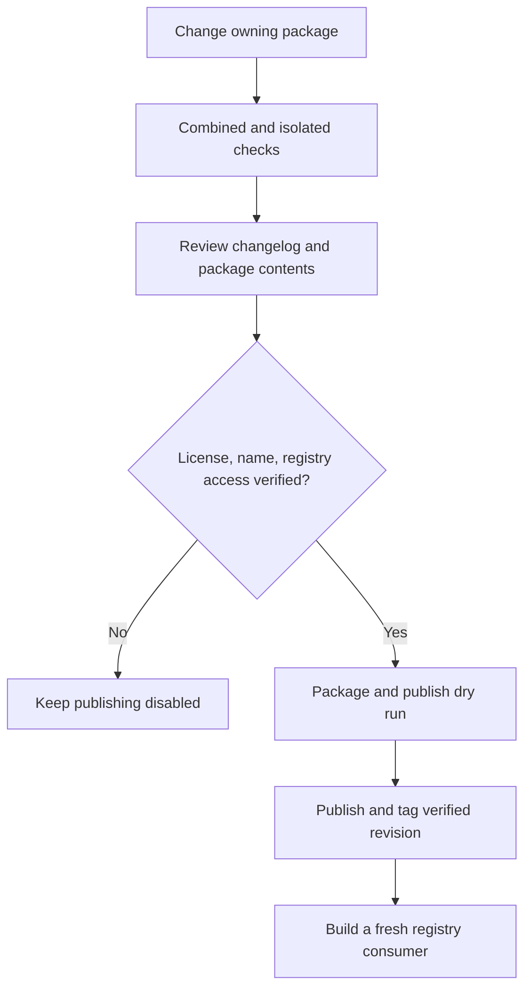

# Package compatibility and releases

Each package has its own version and changelog. Initial scaffolds happen to use
`0.1.0`; that does not require synchronized releases. The facade declares tested
compatible ranges as dependencies appear. Do not expose a lower package's private
implementation as an integration API.

## Release Flow

Use SemVer. During `0.x`, breaking public API changes increment the minor version;
compatible fixes increment the patch version. Public re-exports, documented feature
behavior and MSRV are part of compatibility. Treat an MSRV increase as a breaking
change during this experimental period and document it before release.

Maintain an `Unreleased` section with Added, Changed, Fixed, and Removed subsections
as needed. Before release, record the version and date, migration notes, affected
dependency ranges, supported features, MSRV and verification evidence. Create a
`vX.Y.Z` tag in the owning repository; never retag a published release.

## Publishing gate

The license is MIT OR Apache-2.0 (ADR 0011). All eleven crate names are owned
on crates.io as `0.0.0` placeholders (#84). Every manifest carries its crates.io
metadata and no longer sets `publish = false`; the gate is now
`tools/publish.py`, which uploads nothing without `--execute`.

To release:

1. Run combined and isolated checks against exact dependency revisions, review the
   changelog and publishable file list with `cargo package --list`.
2. `python3 tools/publish.py`: packages and builds every crate in dependency order,
   with unpublished siblings patched in from their checkouts.
3. `python3 tools/publish.py --execute`: uploads in the same order; cargo waits for
   each crate to reach the index. After a failure, fix it and resume with
   `--from NAME`.
4. Verify a fresh consumer using the registry versions. Tag the verified revision
   in each repository.

Core, Kernel and Runtime may release independently; the facade follows only when
it needs their changes. Initial site repository visibility is separate from Cargo
publishing.

## Release Evidence

| Gate | Required evidence |
| --- | --- |
| Package quality | Combined plus isolated format, lint, tests, and rustdoc |
| Boundary safety | Resolved dependency checks for every dependency kind |
| Artifact quality | `cargo package --list`, package verification, publish dry run |
| Consumer behavior | Fresh consumer built from registry versions |
| Compatibility | Changelog, dependency ranges, feature support, MSRV |
| Remote execution | Hosted workflow status, tracked separately from local pass |
